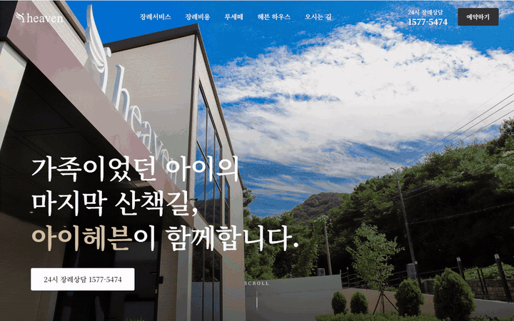
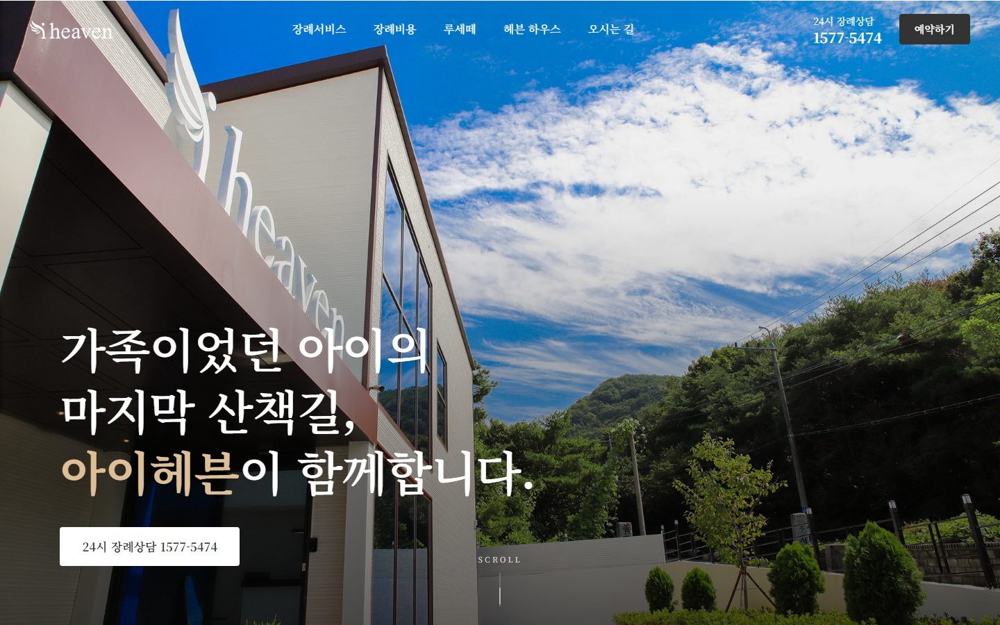
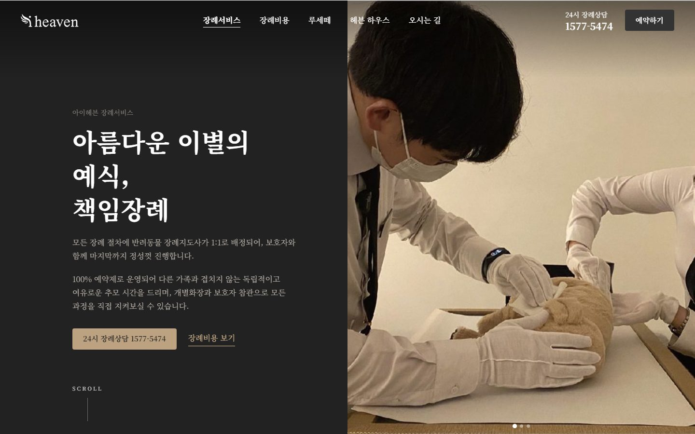
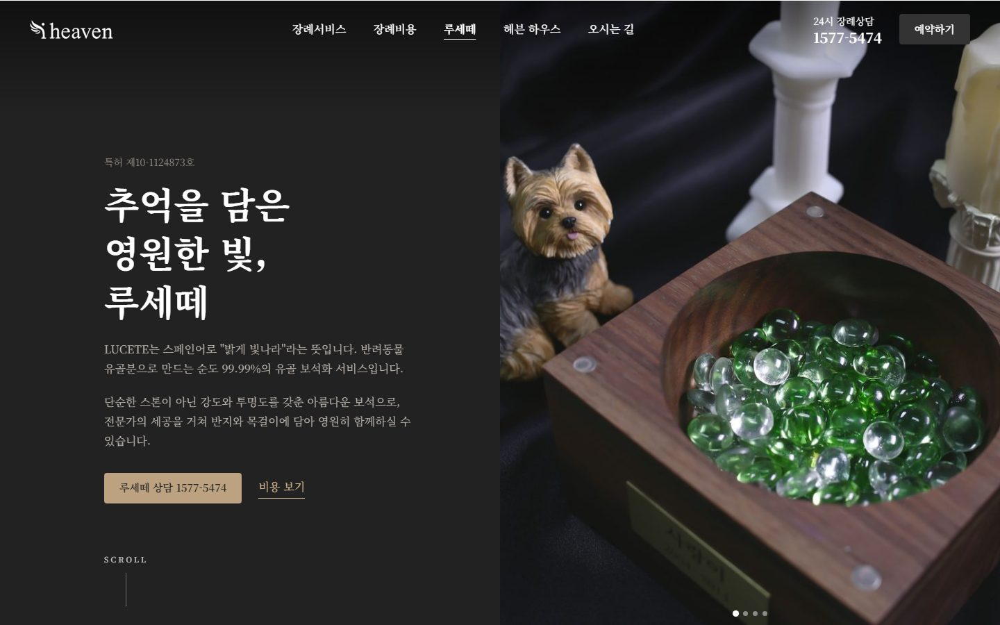
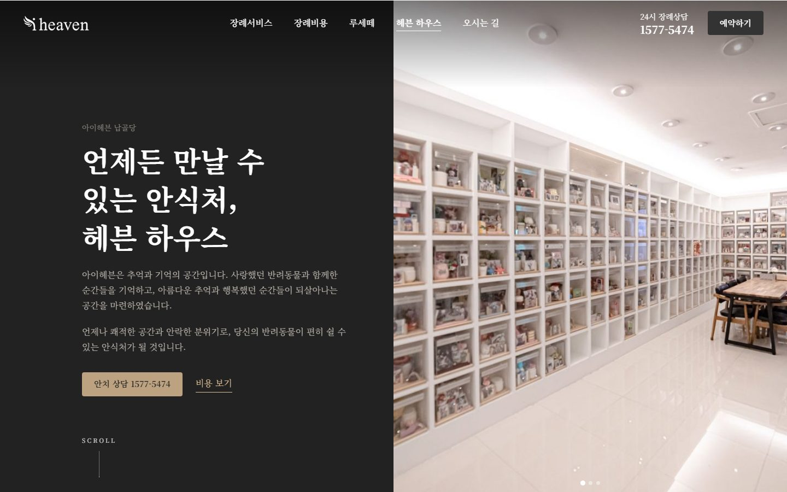
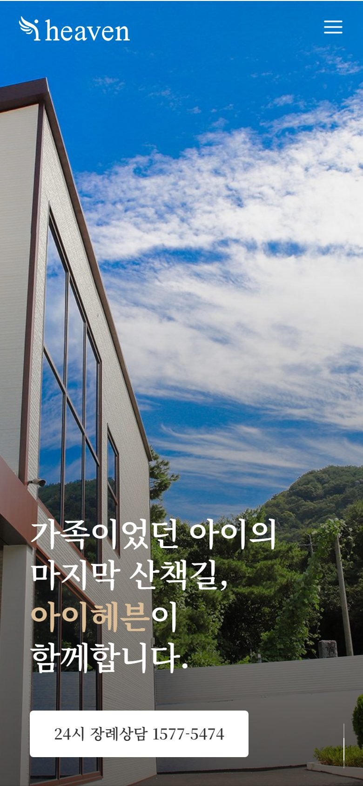

# 아이헤븐 (iheaven)

김해 반려동물 장례식장 아이헤븐 웹사이트: https://i-heaven.kr

Astro 정적 사이트. `main` 에 푸시하면 GitHub Actions(`.github/workflows/deploy.yml`)가 빌드해 GitHub Pages 로 배포한다.

## 화면



| 메인 | 장례서비스 |
|------|-----------|
|  |  |
| **루세떼** | **납골당(헤븐 하우스)** |
|  |  |

모바일 메인:



README 이미지는 `docs/readme/` 에 있다. 실제 사이트(i-heaven.kr)를 데스크톱 1440×900, 모바일 390×844, 영상은 1280×800 으로 찍었다.

## 실행

```sh
npm install
npm run dev      # 로컬 개발 서버
npm run build    # dist/ 로 빌드
npm run preview  # 빌드 결과 미리보기
```

## 구조

| 경로 | 내용 |
|------|------|
| `src/pages/index.astro` | 메인 |
| `src/pages/service.astro` | 장례서비스 |
| `src/pages/lucete.astro` | 루세떼 |
| `src/pages/house.astro` | 납골당 |
| `src/pages/privacy.astro` | 개인정보처리방침 |
| `src/layouts/Base.astro` | 공통 레이아웃(헤더·푸터·메타·전역 스타일) |
| `src/site.js` | 전화번호·예약 링크·주소 등 공통 정보 |
| `public/images/` | 사진 |
| `docs/old-site-content.md` | 사이트 문구·사업자 정보 정리 |

## 디자인

**글꼴**: Noto Serif KR(400·500·600·700) 하나만 쓴다. Google Fonts 에서 불러온다.

**색**: 무채색 바탕에 금색 계열로 강조한다. `Base.astro` 의 `:root` 변수에 모여 있다.

| 변수 | 값 | 쓰임 |
|------|----|------|
| `--gold` | `#bca280` | 금색 버튼, 추천 요금제 테두리 |
| `--gold-deep` | `#a58b6a` | 링크, 현재 메뉴, 헤더 전화번호, 가격 |
| `--gold-light` | `#ddbf97` | 어두운 배경 위 강조, 금색 버튼 호버 |
| `--brand` | `#333` | 기본 버튼, 로고 |
| `--brand-deep` | `#222` | 어두운 섹션·푸터 배경, 기본 버튼 호버 |
| `--soft` | `#f7f5f2` | 연한 섹션 배경 |

**헤더**: 반투명 흰 바탕에 뒤를 흐리는 유리 효과(`backdrop-filter: blur`). 히어로가 있는 페이지의 맨 위에서는 투명 배경에 흰 글씨·흰 로고로 바뀌고, 모바일 하단 상담 바도 숨는다.

**모서리**: 사진은 직각. 카드·안내 상자는 `--radius`(16px)로 둥글게.

**모션**: 장례 사이트라 차분하게 한다.

- 등장 애니메이션은 1초 이상, 이동 거리는 작게, 곡선은 `ease-out`. 페이지 전환은 0.8초.
- 스크롤은 섹션 단위로 넘긴다. 휠·키 한 번에 한 섹션씩 0.9초, 메뉴·앵커 이동은 1.1초. 메인은 전 구간, 상세페이지는 히어로와 첫 섹션 사이만.
- 캐러셀(히어로 사진, 메인 서비스 카드)도 같은 곡선으로 넘긴다. 곡선과 이동 함수는 `Base.astro` 스크립트의 `easeTo`(세로)·`glide`(가로).
- 기기의 「동작 줄이기」 설정이 켜져 있으면 페이징과 자동 넘김을 끈다.
- 호버는 색·밑줄 변화. 예외로 장례서비스의 상세 링크 카드는 제목 뒤 화살표가 4px 움직인다.
- 모바일 탭 깜빡임은 `html` 전역(`-webkit-tap-highlight-color: transparent`)으로 꺼 두었다. 누를 때 피드백은 `:active` 색 변화로.

## 메모

- `build.format: 'file'` 설정이라 하위 페이지가 `privacy.html` 처럼 `index.html` 옆에 생성된다(레이아웃의 상대 경로 때문).
- 전화번호·예약 링크는 `src/site.js` 에서 고친다. 단 `Base.astro` 의 공유 이미지 설명(`og:image:alt`)에 전화번호가 직접 적혀 있으니 같이 바꾼다.
